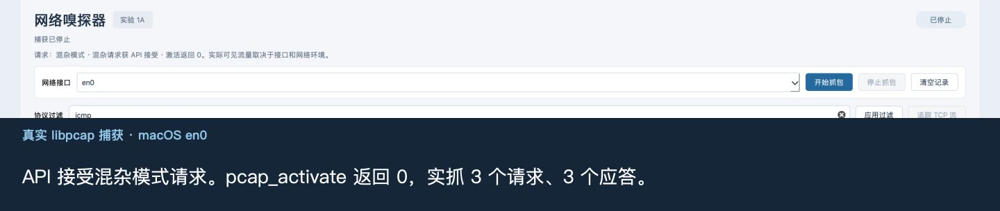
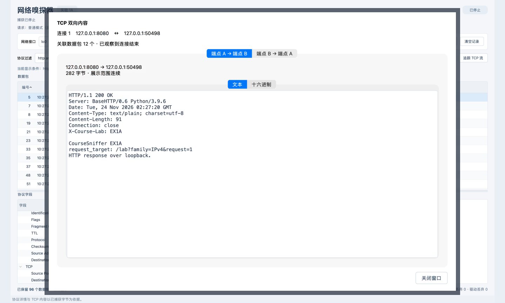

# 网络嗅探器设计与实现

仲泓宇　202618013229068　2026 年 11 月 24 日

公开源码仓库  https://github.com/QTumMayFly/CourseSniffer

## 摘要

本实验依据《软件与系统安全》实验1A的要求，完成网络嗅探器CourseSniffer 1.1.0。系统使用C++17、Qt 6 Widgets和libpcap，实现实时采集、分层解析、逻辑过滤与图形化查看，并支持按照IP地址和端口追踪TCP双向通信。采集与界面处理分离，结合资源限制和临时权限管理控制运行行为。

在macOS 26.6.2 arm64环境下，四组CTest测试通过，并对Wi-Fi物理网卡、回环接口及离线PCAP进行验证。实测确认混杂模式请求成功激活、本机与网关ICMP通信可被捕获，以及HTTP双向流、DNS和ARP报文可被分析。报告限定证据的适用范围，说明HTTPS密文处理边界与AI辅助开发情况。

关键词  网络嗅探，libpcap，Qt 6 Widgets，协议解析，TCP流重组，显示过滤

## Abstract

This report presents CourseSniffer 1.1.0, developed for Experiment 1A of Software and System Security. Built with C++17, Qt 6 Widgets, and libpcap, the application provides live packet capture, layered protocol inspection, logical display filters, and graphical packet views. It also reconstructs bidirectional TCP conversations identified by IP addresses and ports. A dedicated capture worker, bounded buffering, and temporary capture privileges support controlled operation.

Validation on macOS 26.6.2 arm64 included four passing CTest groups, live capture on a Wi-Fi interface and a loopback interface, and analysis of a six-packet offline PCAP sample. Observations support successful activation of a promiscuous-mode request, capture of local ICMP exchanges with the default gateway, inspection of bidirectional HTTP traffic, and decoding of DNS and ARP packets. The report states the limits of these observations, the handling of encrypted TLS traffic, and the use of AI assistance in development.

Key words  Packet sniffing, libpcap, Qt 6 Widgets, protocol analysis, TCP stream reassembly, display filtering

## 第一章 绪论

### 1.1 实验背景与目标

《软件与系统安全》实验1A以网络嗅探器为实践对象，要求程序在真实网络环境中接收数据包，并向使用者展示协议结构及通信内容。网络报文包含多层首部与载荷，仅有原始十六进制数据难以快速定位通信端点、协议类型和应用内容，因此需要将捕获结果转化为可检查的字段结构。课程课件第9、14、15页明确提出NPS实时侦听、图形界面、分层解析与逻辑过滤等要求，按IP地址和端口追踪TCP通信属于加分内容[1]。本实验据此确定功能范围，重点检查采集过程、解析结果与用户操作之间的对应关系，并保留可复核的运行证据。

### 1.2 实验内容与工作范围

CourseSniffer 1.1.0采用C++17、Qt 6 Widgets和libpcap构建桌面程序，覆盖物理网卡与回环接口抓包、协议字段展示、报文检索和TCP双向通信查看。项目代码及相关材料见https://github.com/QTumMayFly/CourseSniffer。实验记录包括自动测试结果、现场抓包和屏幕录像。项目未实现进程归属识别，也未对Wireshark进行二次开发。相关功能及测试描述均以现有实现和实际证据为依据。

## 第二章 实验原理

### 2.1 数据包采集与TCP通信重组

libpcap通过捕获句柄访问网络接口，应用在句柄激活前设定选项，激活后读取链路类型并接收捕获的数据包。其接口与调用约束为采集线程设计提供依据[2]。伯克利包过滤器（BPF）在捕获环节筛选进入程序的数据，图形界面的显示过滤则根据已经收纳的报文及解析字段更新列表。内核过滤控制录制流量的范围，显示过滤控制已收纳报文的呈现结果。

TCP使用端点地址、端口和序号组织可靠字节流[3]。追踪同一连接时，需要识别两个传输方向，依据序号合并相邻片段，处理乱序、重传和重叠数据，并标记缺失区间，避免将不连续的载荷误读为完整应用消息。

### 2.2 应用协议解析与加密通信边界

HTTP/1.x报文识别需检查起始行与头部字段的语法，并在必要时使用TCP重组结果判断跨包消息[4]。libpcap能够获取接口可见的各层报文数据，其中TLS应用载荷受到加密保护，抓包程序只能观察可见的协议字段和密文[5]。DNS名称可能使用压缩指针，解析时必须检查指针目标和数据边界[6]。ARP通过请求与应答完成链路层地址解析[7]。

针对课件Thor思考题，系统安装并信任代理根证书且应用流量经过代理时，代理可分别与客户端、服务器建立TLS连接，读取其代理范围内的HTTP内容。证书固定、绕过代理的连接以及非HTTP应用会限制这一机制的适用范围。CourseSniffer不解密HTTPS。

## 第三章 系统设计与实现

### 3.1 采集线程与权限控制

CaptureWorker在独立线程中执行pcap_create、采集选项配置、pcap_activate、pcap_datalink及pcap_dispatch。采集端采用非阻塞读取，以有界队列传递数据，由GUI线程消费并解析，减少抓包过程对界面响应的影响。单次会话最多保留10000包或64 MiB数据。抓包所需BPF权限采用临时授权，主程序保持普通用户身份，会话结束时恢复设备属性。

非回环接口主动请求混杂模式，仅在明确提示不支持或发生权限错误时回退普通模式。回环接口采用普通模式，界面保留本次会话的模式状态供核查。

### 3.2 协议解析与TCP流管理

解析器按照链路类型处理Ethernet和DLT_NULL，再识别IPv4、IPv6、TCP、UDP、ICMP、ICMPv6及ARP。应用层进一步解析HTTP/1.x和UDP端口53上的DNS报文。HTTP分析检查起始行与头部语法，处理跨包内容。DNS名称压缩解析执行边界检查，防止异常长度或循环指针造成越界读取。

TCP追踪按双端点维护两个方向的序号和载荷状态，处理乱序、重复片段与重叠冲突，并对缺口进行标记。流窗口提供双向文本和十六进制视图，每个方向最多展示1 MiB内容，使较长连接的浏览保持在明确的资源范围内。

### 3.3 图形界面与过滤表达式

Qt 6 Widgets界面由报文列表、协议字段树和十六进制字节区域组成。选择列表条目后，字段树展示分层解析结果，字节区域对应原始报文内容。TCP追踪窗口集中展示同一连接的两个方向。显示过滤器支持and、or、not、括号、IP地址及端口条件，例如http and tcp.port == 8080。

解析过滤表达式失败时，界面报告错误并保留上一次有效条件。非法输入tcp and (用于验证该行为。内核BPF负责限制实际录制流量，界面过滤器负责在已收纳报文中选择显示条目，便于核查采集范围与查看结果。

## 第四章 实验验证与结果

### 4.1 实验环境与自动测试

实测环境为macOS 26.6.2 arm64，使用Qt 6.12.0、Apple Clang 21.0.0、CMake 4.4.5、Ninja 1.13.2和FFmpeg 9.0.2。四组CTest测试均通过，包括核心测试107项、Python生命周期测试17项、QtTest报告9项通过（包含初始化与清理）及桌面启动测试。另有3项依赖实时抓包权限的QtTest用例按默认设置跳过。测试概况列于表4-1。

2026年11月24日10:29（东八区）录制的新版演示视频采用1440×1000分辨率、H.264编码，时长166.25秒。自动测试之外，物理网卡与回环接口还分别保留了真实抓包证据。

构建和测试命令为 `bash scripts/build_macos.sh`。复现录制使用 `bash scripts/record_demo_macos.sh`。

表 4-1 macOS 自动测试结果

| 测试组 | 实际结果 |
| --- | --- |
| 核心协议与流追踪 | 107 项通过 |
| 权限与服务生命周期 | 17 项通过 |
| 桌面交互 | QtTest 9 项通过，3 项需抓包权限的用例默认跳过 |
| 桌面启动 | 通过 |

### 4.2 物理网卡混杂模式验证

在Wi-Fi接口en0上，pcap_set_promisc(1)返回0，pcap_activate返回0，程序保持混杂模式请求状态，普通模式回退标记为false。通过只保留本机与默认网关ICMP回显通信的BPF条件，实际捕获3个Echo请求及3个应答，ping进程退出码为0。混杂模式结果列于表4-2，真实物理网卡模式界面见图4-1，视频约00:10展示该过程。

上述证据确认本机en0接口成功激活并捕获指定端点间的真实报文，尚不足以判定第三方设备之间的流量在该Wi-Fi环境下可见。

表 4-2 en0 混杂模式和网关探测

| 检查项 | 实际结果 |
| --- | --- |
| 物理接口 | en0（Wi-Fi） |
| `pcap_set_promisc(1)` | 返回 0 |
| `pcap_activate()` | 返回 0 |
| 最终请求模式 | 混杂模式，普通模式回退为 false |
| 捕获的 ICMP 报文 | 3 个回显请求，3 个回显应答 |

### 4.3 回环抓包与协议分析验证

lo0以普通模式捕获96包，其中IPv4为50包、IPv6为46包、TCP为74包、UDP为12包、HTTP为18包、ICMPv4为6包、ICMPv6为4包。协议标签跨层重合，各项统计不可直接相加。具体数据列于表4-3。回环实测在视频约00:35出现。相同TCP连接中的GET请求和200 OK响应能够在双向流窗口对应呈现，并可切换十六进制视图，参见图4-2及视频约01:38。

视频约01:32展示无效过滤表达式处理。离线PCAP样本明确包含6包，用于验证DNS A、AAAA查询与响应，以及ARP请求与响应。相关画面位于约02:06。离线样本验证协议解析行为，回环会话验证本机实时通信与交互显示。

表 4-3 lo0 实时捕获统计

| 协议类别 | 实际包数 |
| --- | --- |
| 全部记录 | 96 |
| 网络层 | IPv4 50，IPv6 46 |
| 传输层 | TCP 74，UDP 12 |
| 控制报文 | ICMPv4 6，ICMPv6 4 |
| 应用层 | HTTP 18 |

[macOS 实测记录](validation/macos_recording.json)

## 第五章 结论

### 5.1 实验结论与证据范围

CourseSniffer 1.1.0完成课程实验要求的实时侦听、分层协议展示、逻辑过滤与图形化操作，并实现基于IP地址和端口的TCP双向追踪。线程分工、资源上限、临时权限与异常输入处理构成完整的运行约束，使采集过程、界面操作和协议分析均具有可检查的实现依据。自动测试与现场录像共同支持报告所述功能的完成情况。

实验结论适用于本次macOS环境、具体设备与所用流量样本。物理网卡结果证实混杂模式请求得到接口接受，并成功捕获本机与网关之间的ICMP报文。其证据范围不涵盖第三方设备间流量的可见性。回环HTTP分析与离线DNS、ARP样本反映相应路径的处理结果，不能推及全部协议变体。TLS应用数据仍以密文形式被采集，项目不提供HTTPS解密或进程归属分析。

项目代码、测试和文档使用AI辅助完成。报告采用真实本机测试及录制材料，明确辅助工作与实验结论的关系。公开材料隐去本地网络敏感标识，并保留测试条件与证据边界，以便课程验收时核查。

## 参考文献

[1] 《软件与系统安全》实验1A课程课件，第9、14、15页。

[2] The Tcpdump Group. libpcap Manual Page (pcap(3PCAP)).  https://github.com/the-tcpdump-group/libpcap/blob/master/pcap.3pcap.in

[3] Eddy W. RFC 9293. Transmission Control Protocol (TCP).  https://www.rfc-editor.org/rfc/rfc9293.html

[4] Fielding R., Nottingham M., Reschke J. RFC 9112. HTTP/1.1.  https://www.rfc-editor.org/rfc/rfc9112.html

[5] Rescorla E. RFC 8446. The Transport Layer Security (TLS) Protocol Version 1.3.  https://www.rfc-editor.org/rfc/rfc8446.html

[6] Mockapetris P. RFC 1035. Domain Names—Implementation and Specification.  https://www.rfc-editor.org/rfc/rfc1035.html

[7] Plummer D. RFC 826. An Ethernet Address Resolution Protocol.  https://www.rfc-editor.org/rfc/rfc826.html
