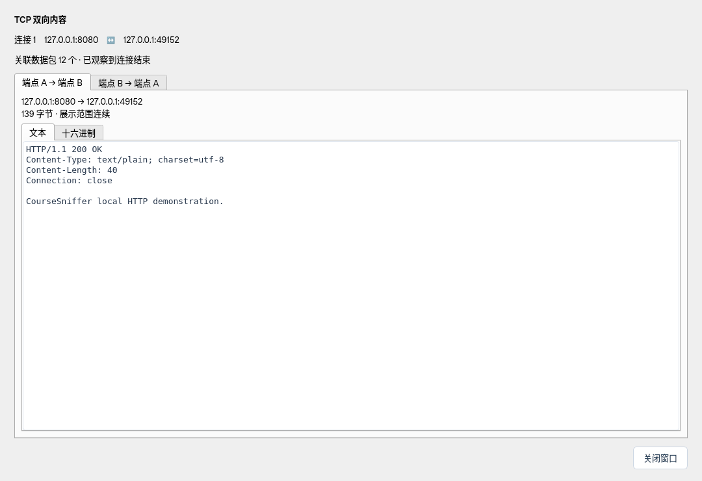

# 实验 1A 网络嗅探器

**实现与验证报告 · CourseSniffer 1.1.0**  
姓名：仲泓宇　学号：202618013229068　目标环境：macOS arm64

本项目采用 C++17、Qt 6 Widgets 和 libpcap，提供实时抓包、图形界面、分层解析、协议及字段逻辑过滤。协议范围覆盖 IPv4、IPv6、TCP、UDP、ICMP、HTTP、DNS 和 ARP。TCP 双向流追踪作为一个主要加分功能。

报告主体说明当前实现、Linux 验证记录及用户提供的 Mac 审计范围。目标 Mac 的完整界面与抓包结果由本机验证脚本采集，导入后附于报告末尾。

## 本机完整验证

在终端进入解压后的 CourseSniffer 目录，以普通用户执行以下命令。该命令使用现有 Homebrew 安装 Qt、CMake 和 Ninja，完成构建、CTest、实际抓包测试及 Cocoa 图形界面验证。

```bash
python3 scripts/verify_macos.py --install-deps
```

所需管理员操作由脚本单独请求。图形界面通过临时 BPF 读取权限以普通用户身份运行，权限会话退出时恢复设备属性。验证结果保存在 `local-validation/verification.json`；实际界面图片位于记录指定的独立目录。

## 日常运行与演示通信

已经安装依赖时，使用构建脚本生成应用并执行测试。内置演示数据用于检查界面、过滤表达式和 TCP 内容。

```bash
bash scripts/build_macos.sh
bash scripts/run_macos.sh --demo
```

实时运行时，选择 lo0 并点击“开始抓包”；在另一终端进入相同项目目录，执行本机通信。停止捕获后选择 HTTP 数据包，打开“追踪 TCP 流”。

```bash
# 终端一：运行实际抓包界面
bash scripts/run_macos.sh
# 终端二：产生 IPv4、IPv6 HTTP 与 UDP 通信
python3 demo/run_demo.py
```

DNS 演示使用 `sudo python3 demo/run_demo.py --dns`，UDP 53 端口绑定需要相应权限。ICMP 演示使用 `ping -c 3 127.0.0.1` 和 `ping6 -c 3 ::1`。选择 en0 后产生正常网络访问，检查接口流量与捕获模式记录。

<!-- pagebreak -->

# 界面与基本操作

主窗口集中展示抓包控制、模式信息、过滤表达式、数据包列表、字段详情和原始字节。下图来自实际 Qt 程序，使用明确标注的内置演示数据。


| 界面区域 | 使用方法与显示内容 |
| --- | --- |
| 网络接口与控制 | 选择 en0 或 lo0；开始、停止和清空当前会话。运行期间保持所选接口。 |
| 捕获模式 | 显示请求模式、API 接受结果、普通模式回退及全部警告；提示中保留 API 返回记录。 |
| 逻辑过滤 | 输入表达式并应用过滤。错误信息包含位置，最近一次有效条件继续生效。 |
| 数据包列表 | 显示时间、端点、已识别协议、长度及摘要；选中记录查看具体字段。 |
| 字段与原始字节 | 按层次展示字段名称、数值、偏移和长度，同时展示十六进制与可打印字符。 |
| TCP 流入口 | 停止捕获后选中 TCP 数据包，查看两个方向的内容及数据状态。 |

开始新会话时，程序提示清空已有记录。清空操作在停止状态可用。关闭窗口时停止读取并回收工作线程。接口失败、权限不足和容量限制均显示具体原因。

`--demo` 使用内置样例；`--demo-pcap demo/sample.pcap` 使用随附样例文件。实际抓包通过第一页的实时运行命令启动。报告附录只从导入的实际验证记录读取 live 截图。

<!-- pagebreak -->

# 抓包、权限与资源管理

CaptureWorker 在独立工作线程中管理 libpcap 句柄和定时器；主线程接收有限批次，完成协议解析、连接更新和界面刷新。PacketRecord 保存原始字节、时间、长度、协议标签和字段偏移。

## 接口与捕获模式

程序使用 `pcap_findalldevs` 读取接口及标志，根据 `PCAP_IF_LOOPBACK` 判断回环接口。非回环接口请求混杂模式，回环接口请求普通模式。句柄由 `pcap_create` 创建，经参数设置和 `pcap_activate` 激活，再读取 `pcap_datalink` 并启用非阻塞读取。[1]

混杂模式请求遇到专属的不支持或权限错误时，程序关闭当前句柄，重新创建普通模式句柄。其他失败保留具体原因。每次请求、激活结果、回退和警告均进入状态记录，界面展示 API 接受情况。

交换式以太网按网络配置转发流量，混杂模式不会使交换机自动转发其他端口的单播通信。Wi-Fi 捕获还受到网卡、驱动、工作模式与加密条件限制。API 接受请求仅说明接口调用结果；实际可见流量由设备和网络条件共同决定。[5][6]

## macOS 权限会话

`capture_permissions_macos.py` 通过系统 sudo 处理 BPF 设备权限，保存原始属性并授予当前用户临时读取权限。应用以当前普通用户身份运行。正常退出、可处理的终止信号和运行超时触发恢复流程；恢复失败保留错误及明确操作说明。macOS 实际设备和 Cocoa 行为通过本机验证命令记录。

## 有限容量处理

| 项目 | 实现参数与行为 |
| --- | --- |
| 单包与读取 | 单包捕获长度 65535 字节；读取周期 20 毫秒，每次最多 256 个数据包。 |
| 界面批次 | 界面周期 100 毫秒，每次最多取出 512 个数据包。 |
| 待处理队列 | 最多 2048 个数据包或 8 MiB 原始字节。 |
| 单次会话 | 最多 10000 个数据包或 64 MiB 原始字节。 |
| 停止与回收 | 非阻塞读取配合线程事件循环；停止后释放句柄，保留已收纳数据和统计。 |

达到队列或会话容量时，程序停止本次捕获并显示原因。原始字节上限之外，解析字段、界面对象和 TCP 内容还会占用额外内存。

<!-- pagebreak -->

# 分层解析与协议字段

PacketParser 根据实际链路类型定位数据。读取同时受 caplen 和协议声明长度限制，整数通过明确的字节序转换函数取得。异常头部、截断内容、未知协议及超出处理范围的情况形成可见状态。

| 层次或协议 | 字段与实现范围 |
| --- | --- |
| Ethernet、DLT_NULL | 源与目标 MAC、EtherType；回环封装读取四个字节的地址族。 |
| IPv4、IPv6 | 地址、长度、TTL 或 Hop Limit、上层协议；按 IPv4 IHL 定位负载，IPv6 最多安全跳过八个常见扩展头部。 |
| TCP、UDP | 源与目标端口；TCP 展示 Seq、Ack、标志、窗口和头部长度；UDP 展示声明长度与校验和。 |
| ICMPv4、ICMPv6 | Type、Code、校验和；Echo 报文展示标识和序号。 |
| HTTP/1.x | 首个请求与响应的起始行、头部字段及来源数据包编号。 |
| DNS | UDP 53 端口的标准查询与响应；ID、Flags、各区记录数量、QNAME、QTYPE、QCLASS 和资源记录。 |
| ARP | Ethernet/IPv4 格式的 HTYPE、PTYPE、HLEN、PLEN、Opcode，以及发送方和目标方的 MAC、IP 地址。 |

## DNS 名称与资源记录

DnsParser 检查头部、记录数量、字段边界和名称压缩指针。支持 A、AAAA、CNAME、NS、PTR、MX、SOA 和 SRV 的相应内容；其他记录保留类型、长度及原始 RDATA 信息。[7]

单报文合计最多处理 128 条问题与资源记录，展开名称最多 255 字节，名称压缩最多跳转 16 次。压缩指针检查已有名称边界、偏移范围及循环。越界、截断、异常长度和超出数量限制均显示具体状态。成功解析的候选报文获得 dns 标签。

## ARP 与解析边界

ArpParser 根据 EtherType 进入 ARP 解析，检查硬件和协议类型及地址长度，展示请求、响应或实际操作码。ARP 地址描述保留在报文详情中；IP 字段过滤只匹配包含实际 IPv4 或 IPv6 层的记录。[8]

IP 分片展示网络层和分片信息。未知链路类型、未支持的 IPv6 扩展内容及异常数据保留已取得字段与原始字节。校验和字段展示捕获值。TCP 流处理接收具有完整传输层信息的数据包。

<!-- pagebreak -->

# 协议与字段逻辑过滤

FilterParser 使用词法分析和递归下降解析建立抽象语法树。有效条件作用于全部已保存记录和后续记录。空表达式显示全部数据；错误表达式包含位置说明，最近一次有效条件继续生效。

## 支持的条件

| 条件类型 | 字段与含义 |
| --- | --- |
| 协议名称 | http、tcp、udp、ipv4、ipv6、icmp、icmp6、dns、arp。icmp 对应 ICMPv4，icmp6 对应 ICMPv6。 |
| IP 地址 | ip.addr 匹配任一端点；ip.src 匹配源地址；ip.dst 匹配目标地址。取值为 IPv4 或 IPv6 数字地址。 |
| TCP 端口 | tcp.port 匹配任一端口；tcp.srcport 匹配源端口；tcp.dstport 匹配目标端口。 |
| UDP 端口 | udp.port、udp.srcport、udp.dstport 分别匹配任一端口、源端口和目标端口。 |
| 逻辑组合 | and、or、not 与圆括号；优先级依次为括号、not、and、or。 |

字段比较使用双等号；端口取值为 0 至 65535 的十进制整数。地址比较使用解析后的二进制地址。IP 条件要求记录包含实际 IP 层；端口条件要求存在相应 TCP 或 UDP 层及端口字段。

```text
http and tcp.port == 8080
dns and udp.port == 53
ip.addr == 127.0.0.1 and tcp
ipv6 and ip.dst == ::1
tcp.srcport == 8080 or udp.dstport == 9999
arp or (icmp and not ipv6)
```

表达式最多 256 个字符，括号最多嵌套 16 层。关键词统一转换为小写。解析器要求完整消费输入，并验证地址、端口、操作符与括号结构。

## 协议标签与会话记录

协议标签可以同时存在。一个 IPv4 HTTP 负载数据包可以同时匹配 http、tcp 和 ipv4；一个解析成功的 DNS 报文同时保留 dns、udp 及 IP 协议标签。

HTTP 识别成功后，连接中携带负载的数据包获得 http 标签，并重新计算当前过滤结果。握手记录可以使用 tcp 条件查看。过滤控制界面显示，TCP 追踪读取当前会话中已经保存的记录。

自动测试覆盖逻辑优先级、括号、无效地址和端口、字段方向、协议存在条件，以及 IPv6 地址比较。

<!-- pagebreak -->

# TCP 内容与 HTTP 识别

TcpTracker 根据地址族和两个端点关联双向连接，利用握手序号区分连接实例。RST、双方 FIN 和中途开始捕获的状态均保留。内容按相对序号整理，处理 SYN 的序号占用及单次回绕。[2]



| 数据情况 | 实现规则 |
| --- | --- |
| 乱序、重复与重叠 | 按序号排列；相同字节展示一次；重叠采用最早捕获内容，并标记不同字节。 |
| 缺口与结束信息 | 保留缺失范围及长度；FIN 可提供结束位置证据；缺少握手时显示起始状态。 |
| 内容上限 | 每方向最多展示 1 MiB；序号跨度小于 2 的 31 次方。文本与十六进制视图共享实际字节。 |
| HTTP 头部 | 每方向整理开头最多 16 KiB 连续字节，识别首个 HTTP/1.0 或 HTTP/1.1 请求与响应。 |

HttpParser 验证起始行、版本、状态码和字段语法，以 CRLF CRLF 确定头部结束。头部跨包时等待所需片段；存在缺口或超过上限时保留状态。识别根据内容生效，演示 HTTP 使用 8080 端口。[3]

头部详情记录实际字段及来源数据包。正文在 TCP 窗口中按原始字节展示；HTTPS 显示可见的网络与传输字段和加密负载。TLS 1.3 的应用数据机密性与完整性机制参见 RFC 8446。[4]

<!-- pagebreak -->

# 验证证据与本机结果

当前 Linux 验证环境为 x86_64、GCC 14.2.0、Qt 6.8.2 和 libpcap 1.10.5。实际日志位于 docs/validation，测试数量及范围以对应记录为依据。

| 检查项目 | 当前证据 |
| --- | --- |
| 核心模块 | 107 项通过，0 项失败；包括 DNS、ARP、协议字段过滤、TCP 内容和 HTTP。 |
| 内存与未定义行为检查 | ASan、UBSan 运行 107 项核心测试通过；使用 detect_leaks=0，泄漏检查范围保持未验证。 |
| GUI 功能 | 7 项功能测试通过；QtTest 包含初始化与清理，总计 9 passed。 |
| 运行生命周期 | 17 项 Python 测试通过；其中 15 项覆盖 BPF 权限处理，2 项覆盖演示服务启动与关闭。 |
| 实际捕获测试 | 3 项默认跳过，目标 Mac 执行真实回环通信、空闲停止和非回环模式测试。 |
| 构建与运行 | Linux 完整编译通过；CTest 的核心模块、运行生命周期、界面交互和界面启动共 4 组通过。 |
| 本机演示通信 | IPv4、IPv6 的 HTTP、UDP 及 UDP 15353 上的 DNS A、AAAA 请求应答通过；记录见 loopback_demo.txt。 |

用户提供的 Mac Clang 审计覆盖 75 项原有核心测试。该信息按用户提供的审计范围记录。1.1.0 的完整 Cocoa 界面、临时权限、UDP 53 绑定和实际抓包结果由目标 Mac 验证脚本采集。

## 本机验证产物

`verify_macos.py` 完成依赖安装、构建与 CTest、具有所需权限的实际抓包测试，以及普通用户运行的 Cocoa 界面验证。实际回环捕获生成 HTTP、UDP、IPv4 和 IPv6 记录，检查字段过滤，保存主窗口及 TCP 内容截图。DNS 和非回环捕获模式由相应实际捕获测试验证。

| 文件或目录 | 记录内容 |
| --- | --- |
| local-validation/verification.json | 应用版本、时间、系统、步骤退出状态、总体结果和实际界面证据。 |
| live_gui_时间戳目录 | capture_proof.json、实际流量日志、main_window_live.png 与 tcp_stream_live.png。 |
| local-validation/live_capture.txt | 实际抓包和模式检查的测试输出。 |

## 将真实 Mac 结果加入报告

在安装 ReportLab 的 Python 环境执行以下命令。源记录必须存在且字段类型正确，截图从 JSON 指定的证据目录读取。

```bash
python3 scripts/render_report.py \
  --validation local-validation/verification.json
```

导入器保留退出失败、缺失 GUI 记录、警告和缺失截图。实际证据页只使用记录关联的 live 图片。没有导入记录时，本报告依据已有证据描述验证范围，不生成当前版本的 Mac 通过结论。

<!-- pagebreak -->

# 核心逻辑说明与引用

## 分层抓取与内容判断

捕获接口提供链路封装与原始字节，解析器根据实际类型逐层定位网络、传输和应用数据。Ethernet 采用以太网头部，回环接口采用相应的回环封装。协议头部的长度字段决定后续数据的起始位置，caplen 决定实际可读取范围。[1]

HTTP 通过起始行和头部语法识别；DNS 根据 UDP 53 候选内容验证查询、响应及资源记录。字段类型、声明长度和连续内容共同提供协议判断依据。TCP 连接中的应用头部可能分布在多个数据包中，因此字节整理参与 HTTP 解析。[2][3][7]

## 关键实现解释

| 主题 | 结合代码说明的内容 |
| --- | --- |
| 头部读取 | 网络字节序、IPv4 IHL、TCP Data Offset、UDP 长度和字段偏移。 |
| DNS 与 ARP | DNS 名称压缩的边界与循环检查；ARP 地址类型、长度及操作码。 |
| 过滤求值 | 词法与语法解析、逻辑优先级、地址和端口条件、协议存在性检查。 |
| TCP 内容 | 双向端点、连接实例、相对序号、重复字节、冲突、缺口和容量限制。 |
| 权限与模式 | 普通用户图形进程、临时设备读取权限、恢复路径和 API 状态记录。 |

## 作者贡献与证据范围

项目代码、测试和文档由 agent 编写。用户提供外部审计信息。报告中的测试结果来自明确列出的日志或导入记录；用户复核和实际操作按相应证据说明。涉及 macOS 图形会话与实际网络捕获的结论以目标设备产物为依据。

可编辑源文件为 docs/implementation_and_validation.md。`scripts/render_report.py` 生成 PDF，支持 `--font` 指定中文 TTF 或 TTC 字体；缺少可用字体时使用 STSong-Light。PDF 中的截图保留各自数据来源说明。

## 引用资料

[1] [libpcap 官方接口与手册](https://github.com/the-tcpdump-group/libpcap)。[2] [RFC 9293：TCP](https://www.rfc-editor.org/rfc/rfc9293.html)。[3] [RFC 9112：HTTP/1.1](https://www.rfc-editor.org/rfc/rfc9112.html)。[4] [RFC 8446：TLS 1.3](https://www.rfc-editor.org/rfc/rfc8446.html)。

[5] [Wireshark：Ethernet 捕获条件](https://wiki.wireshark.org/CaptureSetup/Ethernet)。[6] [Wireshark：WLAN 捕获条件](https://wiki.wireshark.org/CaptureSetup/WLAN)。[7] [RFC 1035：DNS 报文与名称](https://www.rfc-editor.org/rfc/rfc1035.html)。[8] [RFC 826：ARP](https://www.rfc-editor.org/rfc/rfc826.html)。课程范围依据所附《软件与系统安全 · 实验一要求》。
