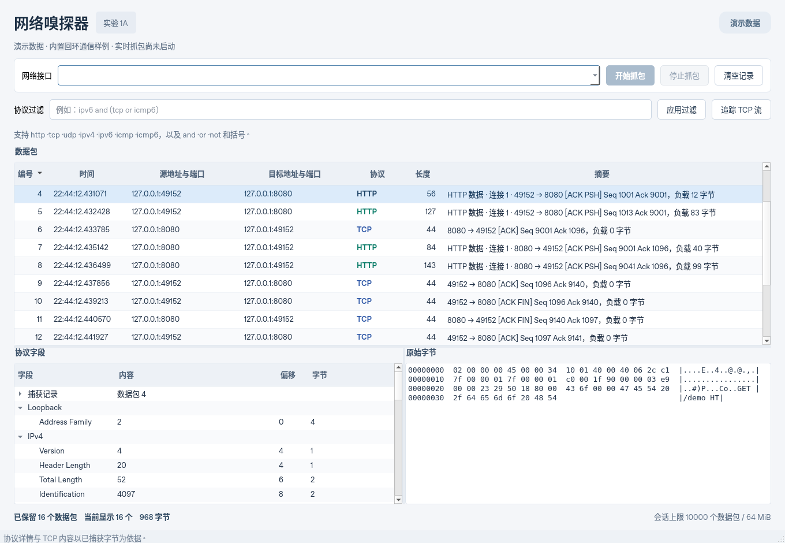

# 实验 1A 网络嗅探器

**实现与验证报告 · CourseSniffer 1.0.0**  
姓名：仲泓宇　学号：202618013229068　目标环境：macOS arm64

本项目采用 C++17、Qt 6 Widgets 和 libpcap，实现实时抓包、交互界面、分层解析与协议逻辑过滤。TCP 双向流追踪作为一个主要加分功能。项目已完成 Linux 编译、核心测试和界面测试；macOS 实际抓包需要在本机执行下列验证。具体记录见第七页。

## 本机快速操作

在终端进入解压后的 CourseSniffer 目录。安装依赖并构建程序；构建脚本会同时运行自动测试。

```bash
brew install qtbase cmake ninja
bash scripts/build_macos.sh
```

使用内置演示数据检查窗口、过滤表达式和 TCP 内容查看。

```bash
bash scripts/run_macos.sh --demo
```

关闭演示窗口后，执行本机抓包自动验证。该命令通过系统 sudo 请求权限，并将结果保存到 local-validation/live_capture.txt。

```bash
bash scripts/validate_capture_macos.sh
```

使用以下命令启动实际抓包界面，选择 lo0，点击“开始抓包”。在另一个终端进入同一项目目录，执行演示通信。

```bash
# 终端一：启动实时抓包界面
bash scripts/run_macos.sh
# 终端二：产生 IPv4、IPv6 HTTP 与 UDP 通信
python3 demo/run_demo.py
```

## 本机检查内容

观察 HTTP、TCP、UDP、IPv4 和 IPv6 数据包；输入 `http and not ipv6` 并应用过滤。停止抓包后，选中 HTTP 数据包并点击“追踪 TCP 流”，检查请求与响应。切换两个方向及文本、十六进制视图。

ICMP 演示使用 `ping -c 3 127.0.0.1` 和 `ping6 -c 3 ::1`。选择 en0 后产生正常网络访问，检查当前接口的流量。完成验证后运行 `bash scripts/validate_local.sh`，保存环境与测试记录，并补充本机截图。

<!-- pagebreak -->

# 界面与基本操作

主窗口将抓包控制、过滤表达式、数据包列表、字段详情和原始字节集中显示。下图来自实际 Qt 程序，加载了明确标注的内置演示数据。



| 界面区域 | 使用方法与显示内容 |
| --- | --- |
| 网络接口与控制 | 选择 en0 或 lo0；开始、停止和清空当前会话。运行期间保持所选接口。 |
| 协议过滤 | 输入表达式并点击“应用过滤”，也可按回车。错误信息包含位置，最近一次有效条件继续生效。 |
| 数据包列表 | 显示时间、双向端点、最高已识别协议、长度及摘要；选中记录可以查看字段。 |
| 协议字段 | 按层次展示字段名称、数值、字节偏移和长度，并显示解析状态。 |
| 原始字节 | 同时展示十六进制和可打印字符，保留实际捕获内容。 |
| TCP 流入口 | 停止捕获后，选中 TCP 数据包，打开双向内容窗口。 |

## 会话与错误处理

开始新会话时，程序明确提示清空已有记录。清空操作在停止状态可用。关闭窗口时，程序停止读取并回收工作线程。接口打开失败、权限不足和资源容量限制均显示具体原因。

`--demo` 加载内置样例；`--demo-pcap demo/sample.pcap` 加载随项目提供的演示文件。窗口中的“演示数据”状态说明当前数据来源。实际抓包通过第一页的实时运行命令启动。

<!-- pagebreak -->

# 模块结构与抓包流程

核心解析模块直接处理捕获到的字节。Qt 主线程维护界面和会话记录，独立工作线程负责 libpcap 句柄及读取定时器。

| 模块 | 实现职责 |
| --- | --- |
| CaptureWorker | 枚举接口，配置和读取 libpcap，管理有限容量队列，停止读取并释放句柄。 |
| PacketRecord、PacketParser | 保存原始数据、时间、长度和字段；完成链路层、网络层及传输层解析。 |
| FilterParser | 识别协议名称和逻辑运算符，建立抽象语法树并判断协议标签。 |
| TcpTracker、HttpParser | 关联双向连接，整理 TCP 字节片段，识别 HTTP 起始行和头部。 |
| MainWindow | 批次接收记录，更新字段、协议标签、会话状态与操作控件。 |
| PacketTableModel | 提供表格数据，结合 QSortFilterProxyModel 更新显示过滤结果。 |
| StreamDialog | 展示两个方向的内容、关联数据包和连续性状态。 |

## 数据处理过程

程序调用 `pcap_findalldevs` 枚举接口，通过 `pcap_create` 创建句柄，配置捕获长度、混杂模式和缓冲超时，再使用 `pcap_activate` 激活句柄。`pcap_datalink` 提供实际链路类型，`pcap_setnonblock` 启用非阻塞读取。[1]

工作线程每次调用 `pcap_dispatch` 读取有限数量的数据包。回调期间复制 caplen 范围内的字节，保存时间戳、原始长度和链路类型。主线程定期取出批次，执行协议解析、连接更新和过滤求值，再刷新界面。

停止操作进入工作线程的事件循环，结束定时读取，取得可用的接口统计，关闭句柄并发送结束通知。界面继续展示已经保存的记录。

## 程序资源上限

| 项目 | 实现参数 |
| --- | --- |
| 单包捕获长度与混杂模式 | 65535 字节；混杂模式关闭。 |
| 读取与界面周期 | 读取周期 20 毫秒，每批最多 256 个；界面周期 100 毫秒，每批最多取出 512 个。 |
| 待处理队列 | 最多 2048 个数据包或 8 MiB 原始字节。 |
| 单次会话 | 最多 10000 个数据包或 64 MiB 原始字节。 |
| HTTP 与 TCP 内容 | 每个方向识别开头 16 KiB HTTP 头部；每个方向最多展示 1 MiB TCP 内容。 |

达到队列或会话容量时，程序停止本次捕获，保留已收纳记录并显示原因。字节上限针对原始数据；解析字段、界面对象及 TCP 内容还会占用额外内存。

<!-- pagebreak -->

# 分层解析与逻辑过滤

协议读取同时检查 caplen 和协议声明长度。网络字节序整数通过明确的读取函数转换。异常长度、截断内容、未知协议及处理范围限制均形成可见状态。

| 层次或协议 | 字段与处理范围 |
| --- | --- |
| Ethernet、DLT_NULL | Ethernet 显示 MAC 与 EtherType；DLT_NULL 读取四个字节的地址族。按实际链路类型定位网络层。 |
| IPv4 | 源地址、目标地址、IHL、总长度、TTL、协议和分片字段；按 IHL 计算头部长度。 |
| IPv6 | 源地址、目标地址、Payload Length、Next Header、Hop Limit；安全跳过常见扩展头部，最多八个。 |
| TCP | 端口、Seq、Ack、标志位、窗口、头部和负载长度；按 Data Offset 定位负载。 |
| UDP | 端口、长度和校验和；用声明长度限定有效负载。 |
| ICMPv4、ICMPv6 | Type、Code、校验和；Echo 报文增加标识和序号。 |
| HTTP/1.0、HTTP/1.1 | 识别首个请求与响应的起始行和头部，并记录相关数据包编号。 |

IPv4 分片和 IPv6 分片展示网络层及分片信息。IPv6 的 Hop-by-Hop、Routing 和 Destination Options 按声明长度跳过；AH、ESP、未知类型和异常扩展长度保留已解析内容及原始字节。校验和字段展示捕获值。

## 显示过滤语法

支持 `http`、`tcp`、`udp`、`ipv4`、`ipv6`、`icmp`、`icmp6`。其中 icmp 对应 ICMPv4，icmp6 对应 ICMPv6。逻辑运算使用 `and`、`or`、`not` 与括号，优先级依次为括号、not、and、or。

```text
tcp and ipv4
udp or icmp
ipv6 and (tcp or icmp6)
http and not ipv6
not (tcp or udp)
```

过滤器执行词法分析和递归下降解析，并要求完整消费输入。表达式最多 256 个字符，括号最多嵌套 16 层。空表达式显示全部记录；关键词统一转换为小写。

一个 HTTP 数据包可以同时具有 http、tcp 和 ipv4 标签。http 匹配已识别 HTTP 连接中携带 TCP 负载的数据包。有效表达式作用于已捕获记录和后续记录；HTTP 标签更新后重新求值。TCP 追踪始终读取会话中已保存的完整记录。

<!-- pagebreak -->

# TCP 双向流追踪

程序按地址族和规范排列的两个 IP 地址、端口组合关联连接，并为连接实例分配编号。重复 SYN 使用方向和初始序号识别；新的握手信息用于区分重复使用相同端点的连接。RST、双方 FIN 和中途开始捕获的情况均保留状态。[2]


| 数据情况 | 内容整理规则 |
| --- | --- |
| 正常与乱序片段 | 根据相对序号排列两个方向的负载，并保留来源数据包编号。 |
| 完整与部分重传 | 已存在的相同字节展示一次；重叠位置采用最早捕获的字节。 |
| 冲突与缺口 | 不同重叠字节显示冲突状态；缺失范围保留位置和长度。FIN 可以提供结束位置证据。 |
| 序号与容量边界 | 处理 SYN 消耗的序号及单次回绕；序号跨度小于 2 的 31 次方；每方向最多展示 1 MiB 内容。 |

内容窗口提供两个方向的文本和十六进制视图。文本替换不可显示字符；十六进制保留原始字节。状态明确标识展示范围连续、捕获起始不完整、存在缺口、存在冲突或达到内容上限。

连接边界依赖已捕获的握手和结束信息。缺少相关证据时，界面提示判断范围。流追踪的自动测试覆盖乱序、重传、重叠、缺口、FIN、序号回绕和端点重复使用。

<!-- pagebreak -->

# HTTP 识别与课程理解

## 根据内容识别应用层报文

HttpParser 验证请求或响应的起始行，再读取以 CRLF 分隔的头部，并用 CRLF CRLF 定位头部结束。请求起始行包含方法、请求目标和 HTTP 版本；响应起始行包含 HTTP 版本和三位状态码。头部名称与字符范围按协议语法检查。[3]

TCP 内容整理为每个方向提供开头最多 16 KiB 的连续字节。头部跨越多个数据包时，解析器等待所需片段；起始范围存在缺口时，状态保留为待补齐。头部超出上限时，界面显示相应说明。成功识别后，程序更新连接中的 HTTP 标签和关联数据包。

本项目识别每个方向的首个 HTTP/1.x 头部。正文在 TCP 内容窗口中按原始字节展示。演示服务使用 8080 端口，验证内容识别能够作用于自定义端口。头部详情保留实际出现的字段及参与识别的数据包编号。

## 抓取层次与解析层次

捕获接口决定程序能够取得的链路封装和原始字节；解析器根据链路类型逐层定位 IP、TCP、UDP 和应用数据。Ethernet 数据包含以太网头部；macOS 回环数据使用相应的回环封装。程序读取实际链路类型，并据此选择头部解析方式。[1]

协议标签反映已经确认的内容。HTTP 识别依赖起始行、版本、字段语法和连续字节。连接端口用于描述端点；报文内容提供应用协议的识别证据。一个应用层头部可以跨越多个 TCP 数据包，因此 TCP 内容整理参与 HTTP 判断。[2][3]

## HTTPS 数据的可见范围

TLS 1.3 对应用数据提供机密性和完整性保护。[4] 本程序展示 HTTPS 通信中可见的 IP、TCP 字段与捕获到的加密负载。请求路径、正文等明文内容的获取需要相应的端点或密钥条件。

课程中的应用代理场景涉及应用层访问位置和信任配置。系统描述文件、受信任证书及代理配置能够在具体部署条件下参与应用层处理；相应工具对 TCP 原始报文细节的可见范围取决于接入方式。对 Thor 的具体机制，报告说明应以实际配置和官方技术资料为依据。

## 本人复核内容

复核抓包接口调用、长度边界、字节序、IPv4 IHL、TCP Data Offset、过滤优先级及序号处理，并结合测试数据解释字段位置和结果。代码由 agent 辅助编写；本人复核记录和 Mac 实际结果由本人补充。

<!-- pagebreak -->

# 实际验证记录

验证依据保存在 docs/validation。当前记录来自 Linux x86_64，编译器 GCC 14.2.0，Qt 6.8.2，libpcap 1.10.5。目标 Mac 的系统版本、实际抓包和界面操作记录需要在本机填写。

| 检查项目 | 当前结果与证据 |
| --- | --- |
| 完整编译 | Linux 配置与编译成功；configure_linux.txt、build_linux.txt。 |
| 核心模块 | 75 项通过，0 项失败；core_tests.txt。覆盖解析、逻辑过滤、TCP 内容与 HTTP。 |
| GUI 功能 | 4 项功能测试通过；gui_tests.txt。QtTest 同时记录初始化与清理，总计 6 passed。 |
| 实际抓包测试 | 2 项权限相关测试默认跳过，等待目标 Mac 执行；gui_tests.txt。 |
| CTest | 3 个测试组通过；ctest_linux.txt。包括核心模块、界面交互和界面启动。 |
| ASan 与 UBSan | 75 项核心测试通过；core_sanitizers.txt。运行使用 detect_leaks=0，泄漏检查状态保持未验证。 |
| 本机演示通信 | IPv4、IPv6 HTTP 与 UDP 通信通过；loopback_demo.txt。 |

回环通信记录证明演示服务与客户端能够正常交换数据。当前执行环境缺少实际网络捕获权限，Mac 抓包测试尚待执行。界面图片使用演示数据，具体数据来源在图注中标明。

## 目标 Mac 的验收记录

| 检查内容 | 通过条件与填写位置 |
| --- | --- |
| 构建与环境 | build_macos.sh 成功；validate_local.sh 保存环境版本及 CTest 结果。 |
| 空闲停止与真实回环捕获 | validate_capture_macos.sh 执行两项测试；保留 local-validation/live_capture.txt。 |
| lo0 协议与过滤 | 运行 demo/run_demo.py、IPv4 ping 和 IPv6 ping；记录全部协议与组合过滤截图。 |
| HTTP 双向内容 | 停止抓包，选择 HTTP 数据包；核对请求、响应、端点和来源数据包。 |
| en0 与操作稳定性 | 产生正常网络访问；连续十次开始和停止；检查停止响应、窗口关闭和错误提示。 |

本机验收日期：待填写。macOS、Clang、Qt 与 libpcap 版本：待填写。实际抓包结果、截图编号及本人说明：待填写。

项目已有测试结果均以随附日志为依据。提交报告使用本人实际完成的 Mac 验收记录，保留运行命令和真实截图。

<!-- pagebreak -->

# 演示、提交与作者贡献

## 演示视频提纲

视频建议约四至六分钟，最终遵守课程网站公布的时长要求。使用真实本机运行画面完成以下内容。

| 建议时段 | 演示内容 |
| --- | --- |
| 0:00 至 0:40 | 说明实验目标、主要功能、运行环境与启动命令。 |
| 0:40 至 1:40 | 选择 lo0 并开始捕获，运行演示脚本，查看 IPv4、IPv6、TCP 和 UDP 字段。 |
| 1:40 至 2:40 | 展示三种逻辑过滤表达式及错误提示；补充 ICMP 数据。 |
| 2:40 至 4:00 | 停止捕获并追踪 HTTP 双向内容，解释端点、序号、重传和缺口状态。 |
| 4:00 至 5:00 | 展示本机测试记录、实际 Git 链接和功能范围。 |

## 课程提交命名

| 项目 | 名称 |
| --- | --- |
| ZIP 与内部顶层目录 | 仲泓宇_202618013229068_EX1A.zip；仲泓宇_202618013229068_EX1A |
| 源码目录 | 仲泓宇_202618013229068_ex1A_src |
| 演示视频 | 仲泓宇_202618013229068_ex1A_play.mp4 |
| PDF 报告 | 仲泓宇_202618013229068_ex1A_report.pdf |

准备真实 MP4、补充本机结果后的 PDF 和源码，实际打开 PDF 并播放 MP4 检查内容，再执行提交包检查脚本：

```bash
python3 scripts/package_submission.py \
  --video /absolute/path/demo.mp4 \
  --report docs/implementation_and_validation.pdf \
  --output /absolute/path/submission
```

报告填写真实 Git 远程 URL：**待本人填写**。Git 保留实际开发提交，仓库访问按课程要求设置。操作说明集中于报告。附件记录的截止时间为 2026 年 11 月 24 日 23:55，最终以课程网站显示为准。上传后保存提交回执。

## 作者贡献与可编辑材料

代码、测试和文档由 agent 辅助编写。本人负责复核核心逻辑、在 Mac 完成验证、录制实际演示并补充真实仓库地址。报告中的本人工作按实际完成情况填写。编辑 docs/implementation_and_validation.md 后，使用 scripts/render_report.py 重新生成 PDF；脚本依赖 ReportLab，支持 `--font` 指定中文字体。

## 引用资料

[1] libpcap 抓包接口与非阻塞读取：[官方仓库与手册](https://github.com/the-tcpdump-group/libpcap)。[2] TCP 序号与连接语义：[RFC 9293](https://www.rfc-editor.org/rfc/rfc9293.html)。[3] HTTP/1.1 报文语法：[RFC 9112](https://www.rfc-editor.org/rfc/rfc9112.html)。[4] TLS 1.3：[RFC 8446](https://www.rfc-editor.org/rfc/rfc8446.html)。课程命名和提交要求依据所附《软件与系统安全 · 实验一要求》。
